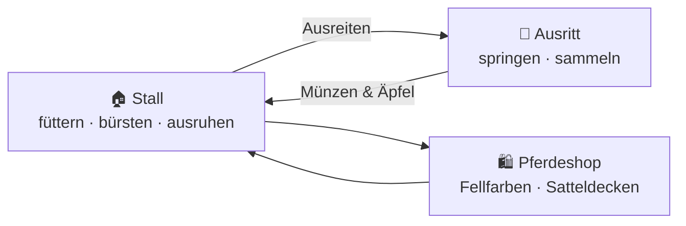

# 🐺 Wolfstal Reiterhof

Ein kleines Browser-Reitspiel (inspiriert von Reitspielen wie Star Stable) – reines HTML, CSS und JavaScript, ohne Build-Schritt und ohne externe Abhängigkeiten.

## Spielprinzip



| Bereich | Was passiert |
|---|---|
| **Stall** | Pferd benennen, mit Äpfeln oder Heu füttern, bürsten, ausruhen lassen. Werte: Futter, Pflege, Energie, Bindung. |
| **Ausritt** | Endlos-Galopp durchs Wolfstal. Über Zäune, Baumstämme, Hecken und Bäche springen, Münzen, Äpfel und Sterne sammeln. |
| **Shop** | 6 Fellfarben (Fuchs, Rappe, Schimmel, Palomino, Schecke, Sternenstaub) und 5 Satteldecken. |

**Pflege lohnt sich:** Energie bestimmt die Anzahl der Herzen beim Ausritt, Bindung erhöht die verdienten Münzen, und ein gut gepflegtes Pferd (≥ 70 % Pflege) bringt einen Glanz-Bonus von 20 %.

**Steuerung:** Leertaste / Pfeil hoch / W oder Tippen = Springen (länger halten = höher), Esc = Pause.

Der Spielstand wird im `localStorage` des Browsers gespeichert.

## Lokal starten

`index.html` einfach im Browser öffnen – oder mit einem lokalen Server:

```bash
python3 -m http.server 8000
# → http://localhost:8000
```

## Deployment (GitHub Pages)

Der Workflow `.github/workflows/pages.yml` prüft bei jedem Push auf `main` die JavaScript-Syntax und veröffentlicht das Spiel auf GitHub Pages.

Einmalig nötig: **Settings → Pages → Source: „GitHub Actions“** auswählen (falls der Workflow das nicht automatisch aktivieren kann).

Danach ist das Spiel erreichbar unter `https://stekum.github.io/Wolfgames/`.

## Projektstruktur

```
index.html   # Seitenstruktur und UI-Panels
style.css    # Layout, responsive bis Smartphone
game.js      # Spiellogik, Canvas-Rendering, Sound (WebAudio), Speicherstand
```
